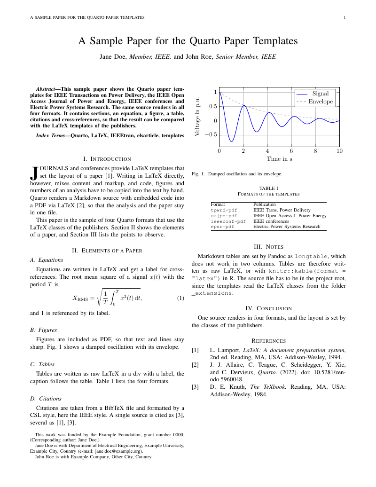
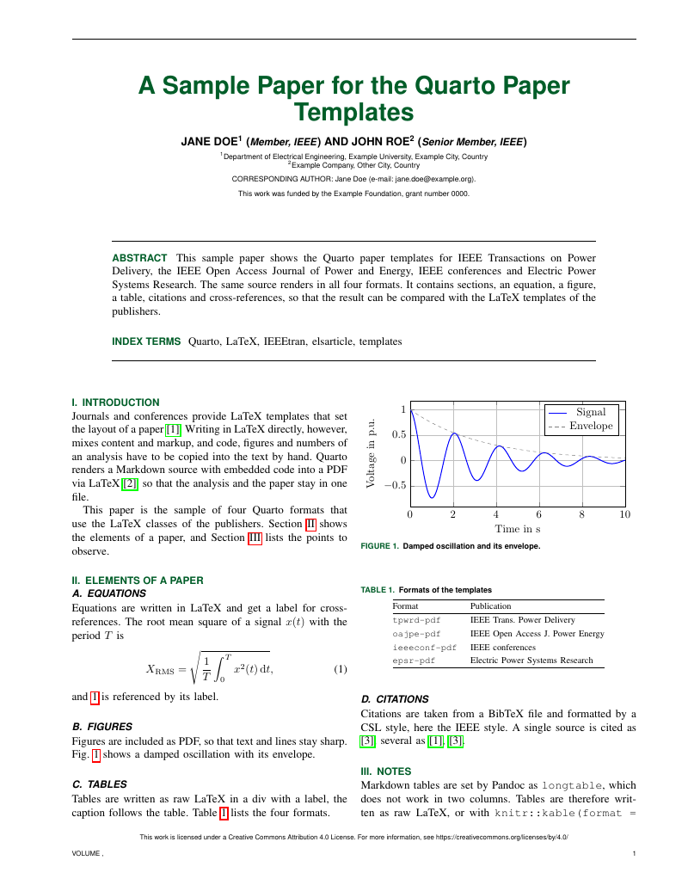
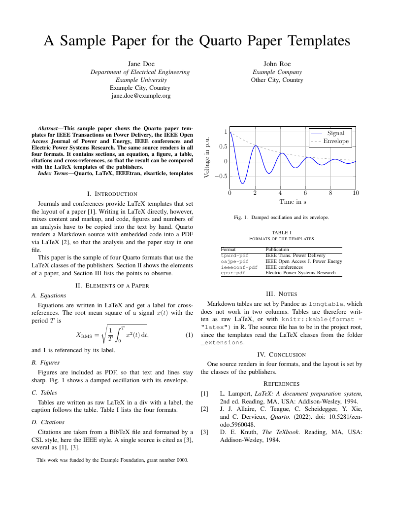
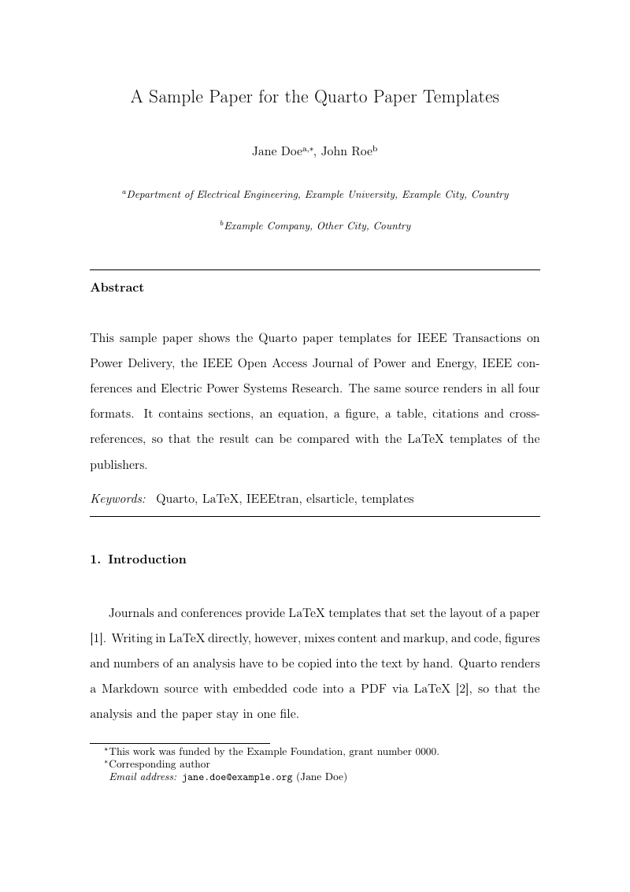

# Quarto Paper Templates

Quarto formats for journal and conference papers that use the LaTeX classes of the publishers:

| Format         | Publication                                            | LaTeX class    |
|----------------|--------------------------------------------------------|----------------|
| `tpwrd-pdf`    | IEEE Transactions on Power Delivery                    | `IEEEtran`     |
| `oajpe-pdf`    | IEEE Open Access Journal of Power and Energy           | `ieeeoj`       |
| `ieeeconf-pdf` | IEEE conferences (template of 06/2024)                 | `IEEEtran`     |
| `epsr-pdf`     | Electric Power Systems Research (Elsevier)             | `elsarticle`   |

[`template.qmd`](template.qmd) is a sample paper that renders in all four formats:

| `tpwrd-pdf` | `oajpe-pdf` | `ieeeconf-pdf` | `epsr-pdf` |
|:-:|:-:|:-:|:-:|
|  |  |  |  |

## Usage

```bash
quarto use template <user>/quarto-paper-templates
```

Then select the format in the YAML header of `template.qmd`, e.g. `format: tpwrd-pdf`.

## YAML header

All formats read `title`, `author` (with `affiliations`, `email`, `attributes: corresponding`), `abstract`, `keywords` and `funding`.
Further fields, ignored by the formats that do not use them:

| Field                     | Formats       | Content                                             |
|---------------------------|---------------|-----------------------------------------------------|
| `author.membership`       | tpwrd, oajpe  | IEEE membership, e.g. `"Member, IEEE"`              |
| `author.bio`, `photo`     | tpwrd, oajpe  | biography with photo (1 in x 1.25 in)               |
| `author.orcid`            | ieeeconf      | shown when no e-mail is given                       |
| `pageheader.left/right`   | tpwrd, oajpe  | running heads                                       |
| `highlights`              | epsr          | research highlights (list)                          |
| `graphical-abstract`      | epsr          | file of the graphical abstract                      |
| `classoption`, `linenumbers` | epsr       | options of `elsarticle`, line numbers               |
| `doiinfo`                 | oajpe         | DOI line of the first page                          |

## Notes

- **Project root:** the templates read the LaTeX classes from `_extensions/<format>/`, so the `.qmd` file has to be in the project root.
- **Tables:** Pandoc sets Markdown tables as `longtable`, which does not work in two columns (IEEE formats).
  Write tables as raw LaTeX in a div with a label (see `template.qmd`) or with `knitr::kable(format = "latex")`.
- **Captions:** the IEEE formats keep the captions of the class (`Fig. 1.`, `TABLE I`), so subfigures are not available.
- **PES logo (oajpe):** the logo of the IEEE PES author kit is not distributed here.
  Copy it from the author kit to `_extensions/oajpe/PES-logo.png`, the first page shows it then.
- **Citations** are formatted by citeproc with a CSL style; `ieee.csl` is from the [Zotero style repository](https://www.zotero.org/styles) (CC BY-SA 3.0).

## Sources and licenses

The LaTeX classes are taken unchanged from the author kits of the publishers:
`IEEEtran.cls` (IEEE, LPPL), `ieeeoj.cls` (IEEE Open Journals, LPPL), `elsarticle.cls` and `epsr.sty` (Elsevier elsarticle bundle, LPPL).
They keep their own licenses.
